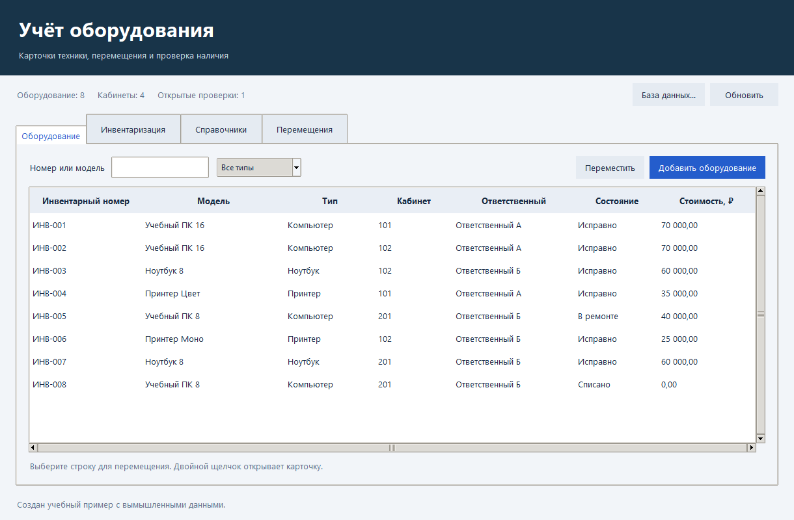

# Учёт оборудования

[](https://github.com/Now2were/equipment-inventory/actions/workflows/checks.yml)

Локальное приложение для учёта компьютеров, ноутбуков и принтеров. Ведите карточки техники, отслеживайте её перемещения и сверяйте наличие по кабинетам. Программа хранит данные в SQLite и работает без сервера и интернета.

**Python 3.12 · Tkinter · SQLite · Windows x64**



## Быстрый старт

**На Windows:** скачайте `EquipmentInventory.exe` из [релиза v1.0.0](../../releases/tag/v1.0.0), сохраните в доступную для записи папку и запустите. Устанавливать Python не нужно.

**Из исходников:** откройте папку репозитория и запустите `python gui.py`. Для графического режима нужен Python с Tkinter; сторонних библиотек для работы программы нет.

При первом запуске создаётся `inventory.sqlite` с вымышленными данными. Через **База данных…** можно открыть другую базу проекта или создать отдельную, пустую либо учебную.

## Возможности

| Раздел | Что можно сделать |
| --- | --- |
| **Оборудование** | Найти карточку по номеру или модели, отфильтровать по типу, посмотреть сведения, добавить единицу техники или оформить её перемещение. |
| **Инвентаризация** | Создать или открыть проверку, отметить наличие, фактический кабинет и состояние, увидеть расхождения, закрыть проверку и выгрузить CSV. |
| **Справочники** | Добавить производителя, модель с характеристиками, кабинет и ответственное лицо. |
| **Перемещения** | Посмотреть историю с датой, инвентарным номером, исходным и новым кабинетами и примечанием. |

Чтобы попробовать весь цикл, добавьте кабинет и карточку, переместите технику, затем создайте проверку. Для каждой позиции укажите **Найдено** или **Отсутствует**. Кнопка **Завершить проверку** сработает после обработки всех позиций; результаты закрытой проверки доступны для просмотра и выгрузки.

При создании проверки сохраняется снимок учётного кабинета и состояния. Фактическая отметка сохраняется отдельно и не изменяет карточку. Перемещение обновляет карточку и историю в одной транзакции. Инвентарный номер уникален; списанные позиции не включаются в новые проверки.

Для резервной копии закройте программу и скопируйте файл базы. CSV — это результаты одной проверки; он не заменяет копию базы.

## Исходники и проверки

| Файлы | Назначение |
| --- | --- |
| `gui.py`, `app.py` | Графический интерфейс, операции учёта и консольные команды. |
| `schema.sql`, `demo.sql` | Восемь связанных таблиц, ограничения, индексы и учебные записи. |
| `queries.sql`, `verify_queries.py` | 16 запросов и проверка их результатов и ограничений базы. |
| `test_app.py`, `test_gui.py` | Тесты операций учёта и графического интерфейса. |
| `build_exe.py`, `requirements-build.txt` | Воспроизводимая сборка Windows EXE. |

```powershell
python -m unittest -v test_app test_gui
python verify_queries.py
```

### Командная строка

```powershell
python app.py --help
python app.py --db tutorial.sqlite init --demo
python app.py --db tutorial.sqlite list --kind PC --room 1
python app.py --db tutorial.sqlite report --inventory 1
```

Команды охватывают справочники (`refs`, `add-manufacturer`, `add-model`, `add-room`, `add-custodian`), карточки (`list`, `add-asset`, `move`), проверки (`start`, `mark`, `close`, `report`, `export`) и аналитику (`query`). Параметры каждой команды показывает `--help`.

### Сборка для Windows

```powershell
python -m pip install -r requirements-build.txt
python build_exe.py
```

Исполняемый файл появится в `dist/EquipmentInventory.exe`. Перенесите его в отдельную папку; при первом запуске он создаст учебную базу рядом с собой.
